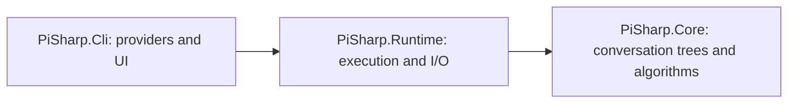

# Architecture

The [configured Pi reference](parity/pi-reference.md) identifies the current
behavioral and visual oracle. Historical fixture pins retain their original
provenance. The normal coding-agent product, including package-resource CLI flows
and interactive visual effects, is in scope. Pure package APIs and experimental
alternate runtimes unreachable from its normal executable are excluded. Overall
parity remains incomplete; `parity/execution-ledger.json` records scoped evidence
and remaining work.

`PiSharp.Core` contains in-memory conversation-tree, edit/diff and read-planning algorithms. Tree selection and branching are deterministic over supplied nodes; `ConversationTree.Append` retains its convenience defaults for generated IDs and UTC timestamps. Core has no provider SDK, terminal, filesystem I/O or process dependencies.

`PiSharp.Runtime` owns the shared agent and session behavior. [Agent execution](capabilities/agent-execution.md) uses Microsoft Agent Framework `ChatClientAgent`, its function invocation and `AgentSession`. `AgentToolCatalog` owns configured selection and session loadouts; `PiCompactionSummarizer` owns bounded prompts/direct summary requests; `PiAgent` retains MAF execution and durable tool binding. `ConversationRun` projects the selected branch into disposable MAF sessions, routes streaming lifecycle events and appends results to canonical application history. [Canonical sessions](capabilities/sessions.md) retain branch-local state and metadata; internal native message/document codecs and explicit path projections own conversion, validation and context estimates. `ConversationStore` persists the native document; `PiJsonlSessionFileStore` and [session interchange](capabilities/session-interchange.md) support Pi JSONL through separate import migration, entry/content conversion, ordered export and run-message projection owners. Stores use atomic writes, process leases and stale-write checks. MAF internal snapshots are not the persistent interchange format.

Runtime capabilities are grouped under sessions, tools, extensions, providers, resources, MCP and Codemode. [Coding tools](capabilities/coding-tools.md) retain a public compatibility facade while internal owners separate file reading, coordinated mutations, shell lifetime and Pi tool declarations. The tool registry controls exposure. `ToolLoadout` owns session selections, pending restored tools and transcript declaration order; `ToolDeclarationTranscript` retains interface revisions separately from executable functions and projects them at the shared provider boundary; `ConversationToolState` restores and persists branch-local tools/store without adding behavior to the CLI. Nested tools reuse the same execution path. [MCP](capabilities/mcp.md) uses the official C# SDK for protocol, discovery, PKCE and OAuth. Internal connection/discovery, tool publication/result and resource-publication owners separate SDK lifetime from startup orchestration. `McpTokenCache` adds Pi's normalized server-name/resource identity, first-reader legacy migration and private cross-process persistence/refresh coordination. Codemode executes JavaScript in a separate Node process with bounded QuickJS/WASM and host-owned tool/model callbacks. Extensions use the .NET registration API, with context transforms applied at each provider request without changing canonical history.

`PiSharp.Cli` composes runtime capabilities with provider adapters, configuration, CLI handling, interactive terminal components and JSON/RPC front ends. All modes use `ConversationRun`; protocol projectors translate runtime state and events instead of owning another agent loop. [Provider/model selection](capabilities/provider-selection.md) separates credential resolution, available snapshots and router discovery from scoped selection. Provider clients implement compatible chat, Responses, Messages, Bedrock, Google and routing boundaries. Anthropic uses the official beta IChatClient beneath the MAF tool loop; its transcript adapter preserves initial tool declarations and inserts later inline changes at valid call/result boundaries. SystemMessageTranscript owns Pi system metadata projection; StoredToolResultReplay restores persisted MEAI result representations. Terminal rendering, keybindings, selectors, clipboard and images belong to the CLI layer. TerminalStartupPresentation builds the theme-aware startup header and project trust notice; Program composes it and TerminalScreenCompositor pins it above the transcript. Startup model-scope and loaded-resource details remain open. TerminalProviderLogin owns the authentication menus and originating-menu cancellation; TerminalProviderOAuthInteraction adapts existing OAuth methods to the terminal. RadiusMcpSetup owns the global provider-auth proposal/write, while the terminal flow invokes the existing runtime reload. [CLI composition](capabilities/cli-composition.md) separates early startup, session document/model selection, JSON prompt handling, settings persistence, clipboard actions, session commands and interactive prompt monitoring. Idle model/thinking replacement has a canonical branch/checkpoint transaction owner; project resource reload and terminal model/thinking navigation have separate owners. Program is the executable composition root: it establishes resource leases, invokes bounded startup/model/conversation preparation and selects the execution mode. Concrete composition and terminal owners implement runtime transitions, mode wiring and UI workflows; current bindings and adoption order remain explicit.

`PiSharp.Tests` mirrors production capabilities beneath `Core/`, `Runtime/`, and `Cli/`, with `Architecture/` checks and shared fixtures, process helpers, and test servers under `TestInfrastructure/`. It covers deterministic Core/runtime behavior, provider HTTP/SSE fixtures, MCP child processes, CLI/RPC processes, and Linux PTY checks. Tests need no live provider credentials. Existing local/CI checks prove their covered slices, not full visual or behavioral parity. The terminal differential harness covers cell/style/cursor/mode states with same-Pi calibration; official MCP conformance remains required. llama.cpp router login/configuration, model management/projection and Hugging Face download have process and terminal fixtures; configuration is shared by chat and native classifiers. Their scoped results and remaining gaps are recorded in the parity inventories.

Session recovery checkpoints prompts, tool intentions/outcomes and assistant history, and does not replay unknown tool side effects. Network-filesystem locking, native platform coverage, complete provider wire parity and current-Pi TUI interactions remain explicit audit work. Project trust gates resource loading; it is separate from process isolation. `ConversationRun` keeps prompt/retry/compaction orchestration and explicit settlement ordering while per-attempt turn journals, request attribution and stream checkpoints have separate owners. Canonical sessions and Pi JSONL interchange have explicit conversion/projection owners behind their public APIs.

[ArchitectureTests](../tests/PiSharp.Tests/Architecture/ArchitectureTests.cs) enforce downward
project references, keep CLI/provider SDK dependencies out of Core/Runtime, and
inspect Core's compiled calls for terminal, filesystem, process and network APIs.
The scanner has a negative control against the test repository reader's real file
calls. These tests run in ordinary `dotnet test PiSharp.slnx`, including Linux CI;
no separate architecture runner or test package is required. Core may reference no
production project; Runtime may reference Core; CLI may reference Runtime/Core.
Generic MAF, MEAI and MCP execution/protocol dependencies belong in Runtime, while
provider-specific SDKs belong in CLI.

CLI composition owns three explicit active bindings: model/agent configuration,
project/settings/trust/resources, and conversation/run/path. Model, branch, reload
and cross-project adoption publish named changes to those bindings; protocol and
terminal callbacks read current state rather than separate mutable root copies.
Concrete provider, project, import and resource command owners implement their
workflows. Program retains process resources, startup sequencing, adapter selection and
explicit mode dispatch. Startup preparation, run-opening policy, model/project
transitions and terminal workflows have separate concrete owners. RPC and
interactive mode composition use direct callbacks into those capabilities; no
application service locator, generic command bus or opaque host/options object
is introduced.

[Repository verification](development/verification.md) includes tracked-path
documentation validation in normal Linux CI. DocumentationPathTests exercises
real Git/Python fixtures, including a local-but-untracked target that must fail.
Historical receipts distinguish committed summaries from unavailable local raw
evidence; the configured Pi reference remains the current verification mechanism.

Capabilities are vertical slices inside the three production projects. Project
boundaries express dependency direction; capability folders express ownership.
Concrete in-process collaborators use direct calls. MAF/MEAI execution remains
direct, while Pi-specific conversation, transcript and persistence semantics retain
application owners. New projects/interfaces require an actual dependency or I/O
boundary rather than a folder or testing preference.

CLI provider implementations are grouped under `Providers/`, JSON and RPC
frontends under `Protocols/Json/` and `Protocols/Rpc/`, and TUI components by
editor, rendering, dialogs, input, clipboard, commands, and themes. These folders
make ownership visible without changing the existing project boundaries.

[Terminal presentation](capabilities/terminal.md) separates timed render scheduling,
conversation content projections and status/authorization state from screen lifetime
and frame composition. Timer callbacks share the screen lock; width/theme accessors
preserve current-value lookup timing. Input and application actions remain in CLI.
TerminalEditor owns draft editing, completion/history, terminal-response subscriptions,
active-run queue/abort and application shortcut dispatch. Concrete dialog input/panel,
progress settlement, transcript-search and authorization-input owners execute the
modal workflows and own their state. Current-screen/input callbacks preserve attachment
and mode lifetimes; no additional terminal framework or project is introduced.
